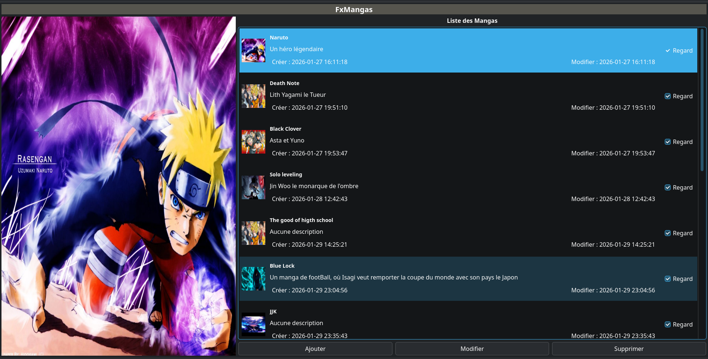
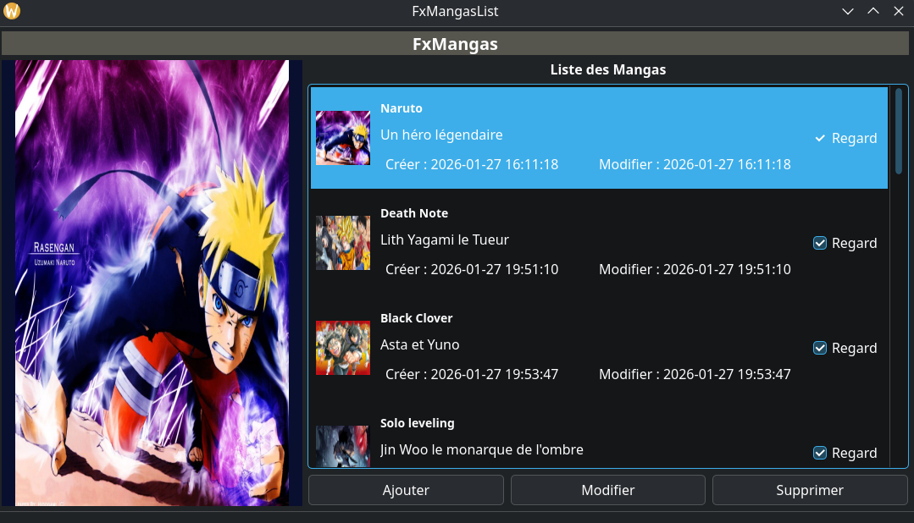

# FxMangas 📚

Une application de bureau native développée en **C++ avec Qt** pour gérer sa bibliothèque de mangas.

## 📸 Aperçu de l'application

  

## ✨ Fonctionnalités
- Ajout, modification et suppression de mangas
- Gestion des images de couverture
- Suivi de lecture avec statut "Regardé"
...
