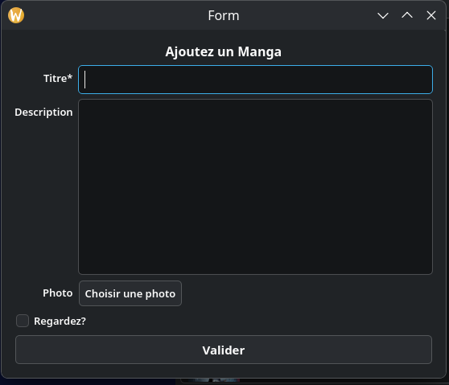
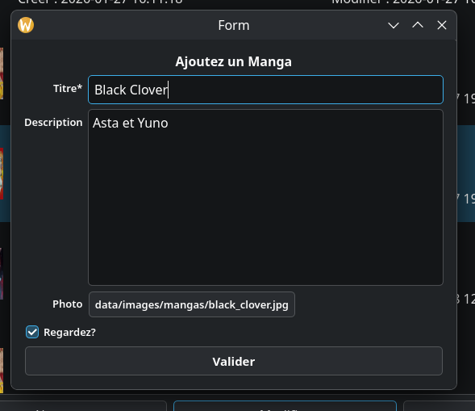

# FxMangas 📚

Une application de bureau native développée en **C++ avec Qt** pour gérer sa bibliothèque de mangas.

## 📸 Aperçu de l'application

## ✨ Fonctionnalités

### Ajout de mangas

  

### Modification de mangas

  

### Suppression de mangas

- Gestion des images de couverture
- Suivi de lecture avec statut "Regardé"
